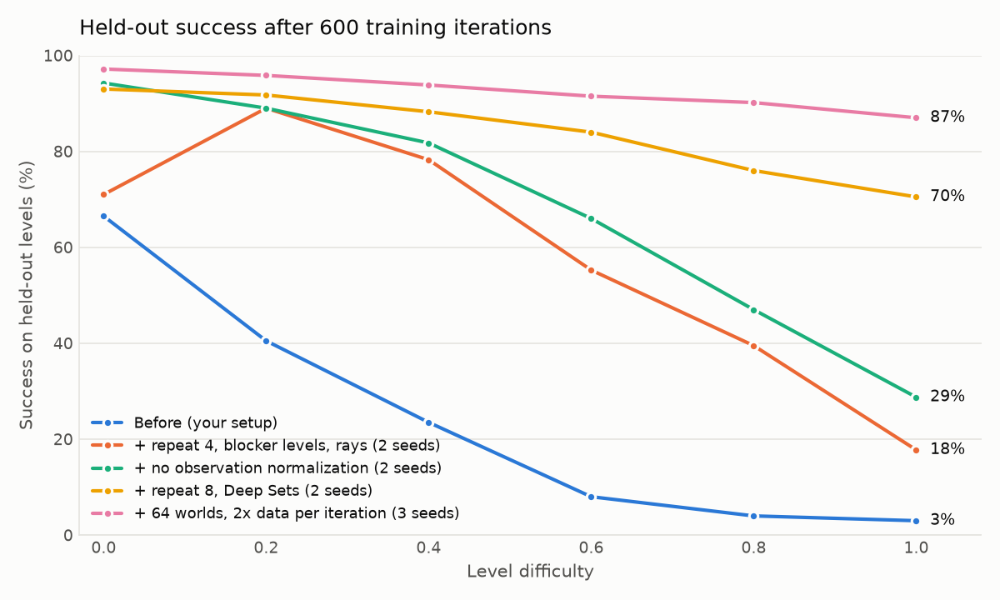

# Outerworld

A 2D space-flight physics game, and a reinforcement learning (RL) agent that learns to fly it. The ship thrusts and
turns from a spawn point to a goal, past circular planets that destroy it on contact and pull it in with gravity.
Levels are procedurally generated. The agent trains on one set of levels and is measured on a separate held-out set
it has never seen, so the results measure general flying skill, not memorized levels.



## Built with

- **C++20** for the simulation, level generator and game: fixed 60 Hz timestep, deterministic, no dependencies
  beyond the standard library and GLM.
- **OpenGL** (through GLAD and GLFW) for the playable game and the replay viewer.
- **CMake, Ninja and MinGW g++ 13** for building; VS Code with CMake Tools.
- **Python 3.14** with **ctypes**: the simulation is compiled into a dynamic-link library (DLL), `outerworld_py.dll`, with a
  plain C interface, which steps many worlds in one call.
- **PyTorch** for the agent, trained with Proximal Policy Optimization (PPO) written from scratch (no RL
  library); **TensorBoard** for training curves; **NumPy** and **Matplotlib**.

## Layout

| Path | Contents |
|---|---|
| `src/` | simulation (`World`, `Ship`, `Obstacle`, `Goal`), level generator (`LevelGen`), distance field for shaping, game and viewer (`main.cpp`), C interface (`capi`) |
| `python/outerworld_env.py` | Gymnasium-style single and batched environments over the shared library |
| `python/outerworldrl.py` | the training script |
| `python/learning/` | earlier exercises (fitting a sine wave, REINFORCE on CartPole) |
| `experiments/` | experiment tooling: configurable trainer, evaluation and analysis, ensembles, distillation, replays; `REPORT.md` and `NOTES.md` hold the full write-up |

## Running

```powershell
cmake -S . -B build -G Ninja; cmake --build build      # or F7 in VS Code

.\build\outerworld.exe                                   # play the test level (W thrust, A/D turn)
.\build\outerworld.exe --seed 1000012345 --difficulty 0.8 --blocker 1
python python\outerworldrl.py                            # train (logs to runs/, view with TensorBoard)
python experiments\replay.py runs\exp\<run>\final.pt --random 5 --difficulty 1.0 --out replays
.\build\outerworld.exe --replay replays\<file>.txt       # watch the agent
python experiments\analyze.py runs\exp\<run>\final.pt 0.0 0.5 1.0 --levels 1000
```

## The agent

- **Observation:** ship velocity and heading, goal position and size, wall distances and local gravity, the 8
  nearest planets (position, radius, density, present), and 16 ray-cast distances to the nearest obstacle.
- **Actions:** 6 combinations of thrust (off or on) and turn (none, left or right), each held for 8 physics steps.
- **Reward:** +10 for reaching the goal, −5 for crashing, plus progress along the shortest route around the planets.
- **Network:** Deep Sets. A small shared network encodes each planet, the encodings are max-pooled over the planets
  present, and a standard network combines the result with the rest of the observation. Separate policy and value
  networks.
- **Training:** PPO over 64 parallel worlds, a difficulty curriculum from 0 to 1, and half
  of the training levels built with a planet directly across the straight line to the goal.

## Findings

What made the difference, in order of discovery:

1. **Action repeat (8 physics steps per decision).** Generalized advantage estimation (GAE) with γλ ≈ 0.94 gives about 17
   decisions of effective lookahead. Without repeat that is 0.3 seconds, too short to connect turning early with
   avoiding a crash a second later. With repeat it is about 2.3 seconds. A control with 4 times the data and no
   repeat did not learn to dodge, so the gain comes from the decision timescale, not the amount of data.
2. **Training levels with a planet in the way.** Ordinary levels rarely need a dodge, so "fly straight" earned
   promotion through the curriculum without the skill. Training only on such levels taught "always swerve"
   instead. A 50/50 mix forces the agent to read the observation.
3. **No running observation normalization.** Planet slots that were always empty early in the curriculum had zero
   variance, so the first real planet in them was normalized to ±10. Patching only the saved statistics of a
   trained agent raised success on levels with 6+ planets from 1% to 28%. The raw features are already scaled to
   about ±1.
4. **Deep Sets for the planets.** Sharing one network across planets, with pooling that ignores order, added 20–28
   points on hard levels and lets the agent handle levels with more planets than it ever trained on.
5. **64 parallel worlds instead of 32.** More independent levels per update; modestly better even with equal data.
6. **Learning-rate annealing to zero** added 1–2 points and fewer stuck episodes.
7. **The remaining failures are agent-specific.** Four strong agents fail on largely different levels (only 10 of
   1000 levels beat all of them). Averaging two agents' action probabilities reaches 97%, and distilling that
   ensemble into one network (the student plays, the ensemble labels its states) gives the best single policy. A
   control that distilled an agent into itself showed no gain.

**No measurable effect:** λ of 0.90 or 0.98, kind of early stopping, network width, entropy coefficient, learning
rate 0.001, max-and-mean pooling, straight-line versus route-based progress reward, and treating timeouts as failures. A
per-decision time penalty reduced stuck episodes but added crashes, for no net gain in success. Removing the progress reward entirely still works, but worse.

## Results

Success on held-out levels (greedy actions, 200 levels per difficulty):

| | 0.0 | 0.2 | 0.4 | 0.6 | 0.8 | 1.0 | planet in the way |
|---|---|---|---|---|---|---|---|
| starting point | 67% | 41% | 23% | 8% | 4% | 3% | 1% |
| `outerworldrl.py`, 2000 iterations | 96% | 100% | 98% | 96% | 96% | 96% | 100% |
| distilled ensemble (best single network) | 98% | 98% | 99% | 97% | 98% | 96% | 100% |

- **Training levels versus held-out levels:** the same success on both (72% held-out and 69% on training levels at difficulty 1.0, for an earlier agent), so the agent learned skills rather than levels.
- **Levels with more planets than in training** (no retraining): 83% with 9–10 planets and 69% with 11–12, against 91% on the 6–8 it trained on.
- **What's left at difficulty 1.0:** about 4% of levels are failed, nearly all of them solvable. Sampling actions solves all but one of the levels no agent solved greedily.
- **Path efficiency** (route flown divided by the shortest route): about 1.17 at difficulty 1.0. The agent detours more around a planet blocking the straight line (median 1.26).

## Next steps

- **Faster, more direct routes:** compare a per-decision time penalty, a lower discount and a smaller crash
  penalty on the trade-off between success, path efficiency and time to goal.
- **Bring annealing and distillation into the main training script.**
- **Train with more observation slots:** first separate the generator's planet maximum from the observation's slot
  count, so existing seeds keep their levels.
- **Attention over planets** instead of max pooling, so planets can be related to each other (for example, a gap
  between two planets).
- **Generalize over physics:** randomize thrust, drag and gravity per level.
- **Behaviour cloning from human play** (replays record every action), then fine-tuning with RL.
- **A value-based method**, a deep Q-network (DQN), on the same environment, for comparison.
